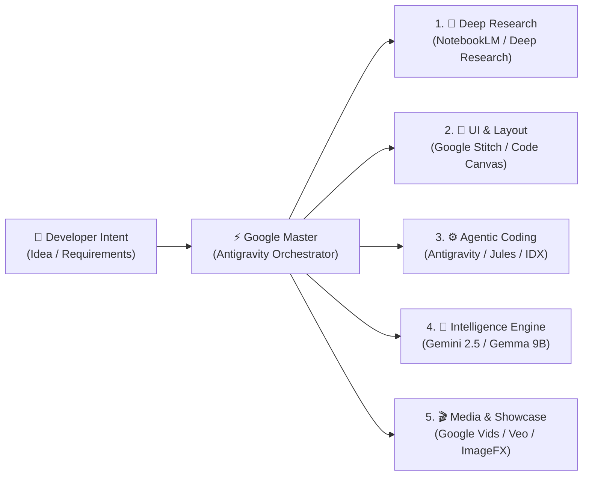

# 🚀 Google Master

<div align="center">

[](https://opensource.org/licenses/MIT)
[](https://drhomerender.github.io/google-Master/)
[](https://github.com/DrHomeRender/google-Master)
[](https://ai.google.dev)
[](https://github.com/DrHomeRender/google-Master/pulls)

**The Autonomous Google AI Ecosystem Orchestrator & Antigravity Copilot**

*Orchestrating 15+ cutting-edge Google AI tools into a seamless, agent-driven engineering pipeline.*

[🌐 Live Demo Hub](https://drhomerender.github.io/google-Master/) | [English](./README.md) | [한국어 문서](./README.ko.md)

</div>

---

## 🌟 Why Google Master?

Google provides an unrivaled array of state-of-the-art AI instruments—from **Stitch** for prompt-to-UI generation, **NotebookLM** for hallucination-free research RAG, **AI Studio & Vertex AI** for Gemini models, **Gemma** for private on-device edge computing, to **Veo & Vids** for automated release showcases.

However, developers frequently struggle with:
1. Knowing *which* Google tool is ideal for their current development stage.
2. Manually switching contexts across dozens of browser tabs and consoles.
3. Lack of agentic automation connecting Google tools directly into their IDE.

**Google Master** solves this by pairing **Google Antigravity's autonomous agent engine** with a structured **5-Phase AI Pipeline** and an interactive **Visual Command Center**.

---

## 🗺️ The 5-Phase Pipeline Architecture



---

## ⚡ Key Highlights

### 1. 🤖 Antigravity Native Engine (`.agents/`)
Drop Google Master into any workspace, and Antigravity automatically gains:
* **Proactive Intent Routing (`rules/google-master-guide.md`)**: Automatically senses when you're drafting UI, picking tech stacks, or integrating models, steering you toward the optimal Google tool.
* **`google-master` Orchestrator Skill**: Generates customized multi-stage engineering pipelines and prompt synthesizers.
* **Specialized Sub-Skills**:
  * `google-stitch-ui`: UI prompt generation & HTML/CSS component modularization.
  * `google-deep-research`: Deep Research queries & NotebookLM knowledge packaging.
  * `google-model-hub`: Gemini API SDK integration & local Gemma (Ollama/vLLM) serving.

### 2. 🖥️ Interactive Web Command Center (`web/`)
A modern, dark/glassmorphic web dashboard inspired by Google DeepMind:
* **Intent-to-Pipeline Generator**: Type any application concept (e.g. *"On-device PDF podcast summarizer"*), and receive a visual 5-step roadmap.
* **Prompt Forge**: 1-click tailored prompts formatted specifically for Google Stitch, NotebookLM, AI Studio, and Veo.
* **Tool Catalog**: Filterable directory of all 15 Google AI tools with Antigravity pairing tips and deep-links.

---

## 🧰 Supported Google AI Ecosystem Tools

| Category | Tool | Core Capability | Antigravity Pairing |
| :--- | :--- | :--- | :--- |
| **UI & Frontend** | **Google Stitch** | Prompt/sketch to responsive HTML/CSS | Generates Stitch prompts & imports raw code into modular components |
| | **Project IDX** | Cloud IDE with cross-platform emulators | Instant previewing & cross-device testing |
| | **Code Canvas** | Real-time interactive UI rendering in Gemini | Interactive micro-component visual tuning |
| **Dev Infra & Models** | **Antigravity & Jules** | Autonomous agent refactoring & coding | Central command hub for codebase execution |
| | **Google AI Studio** | Fast Gemini prototyping & API extraction | System instruction injection & JSON schema code generation |
| | **Vertex AI** | Enterprise MLOps & model fine-tuning | Production enterprise deployment |
| | **Gemma (2B/9B/27B)** | High-performance open-weight local models | Free, private on-device local serving (Ollama/Transformers) |
| **Workspace & Office** | **Gemini Advanced** | 1M–2M token context analysis | Rapid ingestion of massive specification documents |
| | **Workspace Gemini** | AI sidepanel in Docs, Sheets, Gmail | Sheet formula automation & client documentation export |
| **Research & RAG** | **NotebookLM** | Document-grounded RAG & audio podcasts | Clean markdown specification grounding & zero-hallucination Q&A |
| | **Deep Research** | Multi-step autonomous web research | Objective benchmarks & tech stack trade-off reports |
| | **Guided Learning** | Socratic learning & flashcards | Accelerated developer onboarding to new paradigms |
| **Creative & Media** | **Google Vids** | End-to-end presentation video generation | Automated product launch demo videos |
| | **Veo & Flow** | 1080p cinematic video generation | Hero background video assets for landing pages |
| | **AI Test Kitchen** | ImageFX & MusicFX creative generation | App logo concepts, UI illustrations, ambient audio |
| **Privacy** | **Temporary Chat** | Disposable, non-logged AI sessions | Isolated testing for sensitive business logic or API keys |

---

## 🚀 Quick Start

### Option A: Use with Google Antigravity
Clone or copy this repository into your workspace. Antigravity automatically discovers the customizations in `.agents/`:

```bash
git clone git@github.com:DrHomeRender/google-Master.git
cd google-Master
```

Now in your Antigravity prompt, simply describe what you want to build:
```text
"I want to build a real-time multimodal travel planner."
```
Antigravity will proactively invoke the Google Master workflow, draft your Stitch UI prompts, generate NotebookLM research packages, and wire up the Gemini API.

---

### Option B: Launch the Interactive Web Hub

You can run the visual command center locally using any standard static file server:

```bash
# Using Python
python -m http.server 3000 --directory web

# Or using Node
npx -y serve web -p 3000
```

Open `http://localhost:3000` in your browser.

---

## 📂 Repository Structure

```text
google-Master/
├── .agents/
│   ├── rules/
│   │   └── google-master-guide.md       # Proactive Google AI tool recommendation rule
│   └── skills/
│       ├── google-master/               # Master orchestrator & pipeline router
│       │   ├── SKILL.md
│       │   └── references/tools-directory.md
│       ├── google-stitch-ui/            # Stitch UI prompt & HTML/CSS integration
│       │   └── SKILL.md
│       ├── google-deep-research/        # Deep Research & NotebookLM RAG packaging
│       │   └── SKILL.md
│       └── google-model-hub/            # Gemini API & Gemma local serving
│           └── SKILL.md
├── web/                                 # Interactive Web Command Center
│   ├── index.html                       # Modern dashboard markup
│   ├── style.css                        # Glassmorphic DeepMind-inspired styling
│   └── app.js                           # Intent engine & Prompt Forge logic
├── 구글 앱 정리.md                      # Original Korean Google AI Tools Directory
├── README.md                            # Official Global English Documentation
├── README.ko.md                         # Korean Documentation
├── LICENSE                              # MIT License
└── .gitignore                           # Git ignore definitions
```

---

## 🤝 Contributing

Contributions from the global open-source community are welcome!
1. Fork the Project
2. Create your Feature Branch (`git checkout -b feature/NewToolIntegration`)
3. Commit your Changes (`git commit -m 'feat: add support for new Google AI capability'`)
4. Push to the Branch (`git push origin feature/NewToolIntegration`)
5. Open a Pull Request

---

## 📄 License

Distributed under the **MIT License**. See [LICENSE](./LICENSE) for more information.

<div align="center">
Made with ❤️ for the global AI developer community.
</div>
